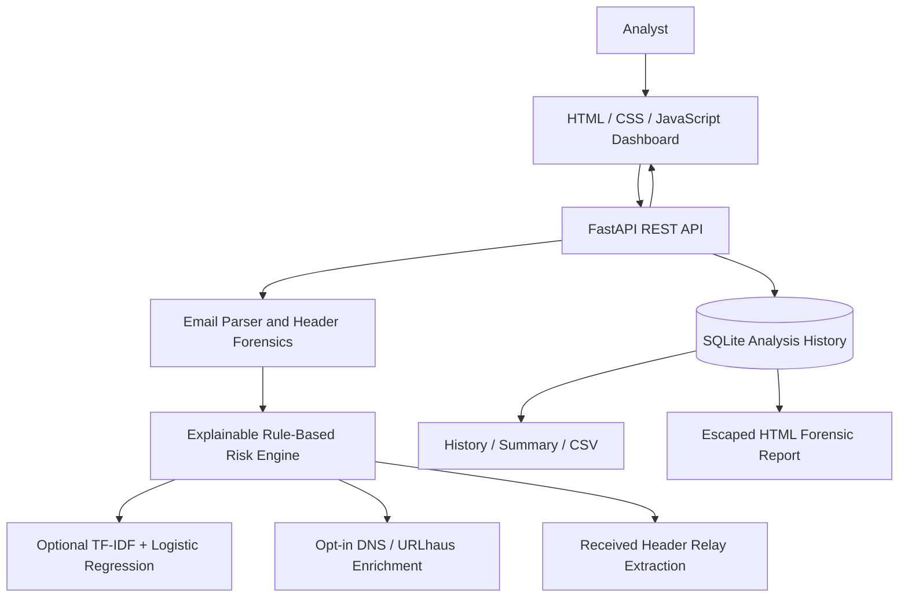

# MailSleuth Architecture

## Data flow
1. Analyst pastes text, headers or uploads an `.eml` file.
2. API validates request sizes and parses the message with Python's email parser.
3. Rule engine emits point contributions with explanations and evidence.
4. Optional ML adds a separately labeled model signal; the rules remain auditable.
5. Optional enrichment queries the sender domain only. It does not upload the message body.
6. Analysis evidence is stored in SQLite and rendered as escaped text in dashboard/report views.

## Trust boundaries
- User-provided email content and headers are untrusted.
- External DNS and reputation providers are outside the local trust boundary.
- `Received` headers are evidence to inspect, not trusted truth.
- ML output is advisory and must not be the only basis for blocking or escalation.
